<!-- Animated header -->

<!-- Typing SVG -->

 

<!-- Badges -->

<h3 align="center">👨‍💻 About Me</h3>

  🎓 B.Sc. in <b>Computer Science &amp; Engineering</b> from <b>CUET</b> 
  🌐 Interested in <b>LLMs</b> · <b>Agentic Systems</b> · <b>Computer Networks</b> · <b>NDN</b> · <b>Distributed Security</b>

<h3 align="center">🛠️ Tech Stack</h3>

 

<h3 align="center">📊 GitHub Analytics</h3>

<table border="0">
  <tr>
    <td></td>
    <td></td>
  </tr>
  <tr>
    <td colspan="2" align="center"></td>
  </tr>
</table>

 

<!-- Snake animation (generated by .github/workflows/snake.yml) -->

<picture>
  <source media="(prefers-color-scheme: dark)" srcset="https://raw.githubusercontent.com/tawsif76/tawsif76/output/github-snake-dark.svg" />
  <source media="(prefers-color-scheme: light)" srcset="https://raw.githubusercontent.com/tawsif76/tawsif76/output/github-snake.svg" />
  
</picture>

  

